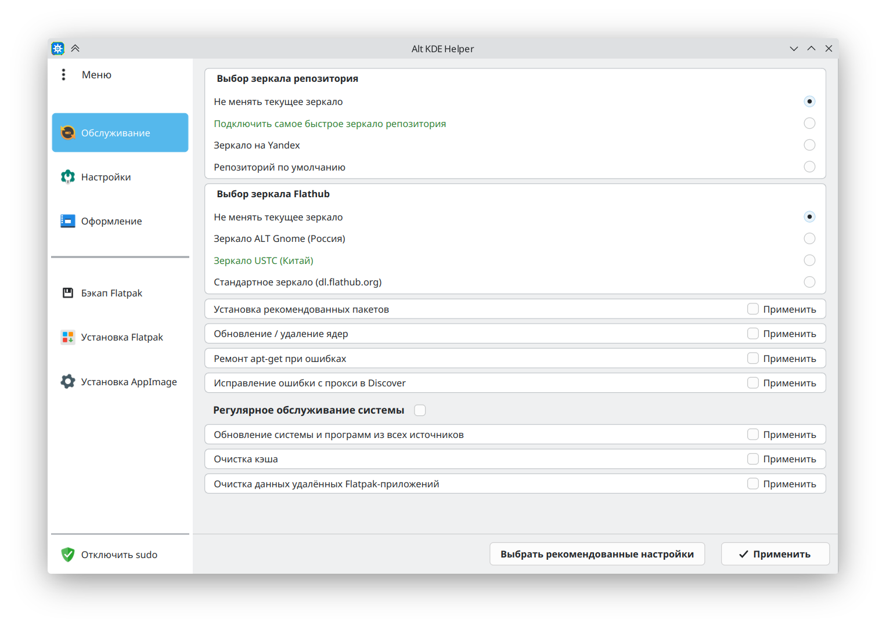

# Alt KDE Helper

<h2 align="center"><em>«Пользователь должен улыбаться, а не красноглазить»</em></h2>

## Описание программы

Программа предназначена для настройки и обслуживания операционных систем ALT Linux 11 с рабочим столом KDE6 — KWorkstation и особенно Starterkit, который можно одним кликом привести в полностью готовый для работы дистрибутив, оставаясь быстрым и лёгким, но полностью функциональным. Добавлена экспериментально поддержка Sisyphus, но без каких-либо гарантий, так как это тестовый, постоянно меняющийся репозиторий. Также заранее добавлена поддержка p12, так как на Сизифе сейчас все работает корректно.
Форум для обсуждения: https://forum.altlinux.org/index.php?topic=49855.0

Telegram-канал (новости и поддержка): https://t.me/Alt_KDE_Helper

Зеркало на altlinux.space: https://altlinux.space/kullibbin/alt-kde-helper/packages

**Основные функции:**

- установка доп. пакетов для получения максимально настроенной системы, особенно актуально для StarterKit и Regular. Редактировать список пакетов можно в меню, в левом верхнем углу приложения
- включение отключенных по умолчанию опций (например, загрузку виджетов и тем)
- получение sudo и прав на его использование
- **отключение sudo одной кнопкой в левой панели программы** — после настройки системы вы можете вернуть её в безопасное состояние, закрыв доступ к правам администратора
- настройка современного интерфейса в один клик — три режима (светлая/светлая, тёмная/светлая, тёмная/тёмная) с автоустановкой иконок Papirus и возможностью отката к предыдущему виду
- добавление пользователя в группы lp, dialout, adbusers, настройка прав для USBasp устройств
- установка VirtualBox со всеми дополнениями
- загрузка кодека openh264 без применения VPN
- выбор зеркал репозитория (есть выбор самого быстрого по результатам теста). Автоматически определяется p11, p12  или Sisyphus. Выбор зеркал flathub
- включение создания миниатюр для значков файлов 3D-моделей, FreeCAD и AutoCAD
- установка и удаление дополнительных источников приложений: Flatpak, Stapler (stplr), epm
- установка AppImage-приложений через магазин AM-GUI — программа установит магазин при первом обращении, а поиск, обновление и удаление приложений выполняются уже внутри него
- обновление самого пакета eepm и программ из epm play
- ремонт apt-get при ошибке базы данных
- исправление ошибки Discover после использования прокси
- доступ для Flatpak ко всему домашнему каталогу на чтение — для возможности перетаскивать файлы мышкой на окно приложения. Это безопасно, так как если программе изначально нужен такой доступ — она его по умолчанию уже имеет
- глубокая очистка кэшей — в домашнем каталоге, для обычных и Flatpak-приложений, удаление старых журналов и сжатие до размера 100 МБ максимум, очистка кэша пакетов (без применения небезопасной опции autoremove), удаление неиспользуемых рантаймов Flatpak
- очистка данных от удалённых Flatpak-приложений — находит в `~/.var/app` папки приложений, которых больше нет в системе, показывает их список с именами и перемещает в корзину по подтверждению
- архивация и восстановление Flatpak-приложений полностью оффлайн — без интернета. Можно сохранить все программы вместе с данными, чтобы потом восстановить их оффлайн, либо сохранить только данные и настройки (пароли, закладки, историю, сессии, переписки). Восстановить бэкап можно на этой же или другой машине
- создание своего списка программ для быстрой пакетной установки через интернет: программа сохранит все ваши Flatpak-приложения в отдельный список, по которому на другом компьютере всё установится в один клик. При этом можно ставить как все приложения сразу, так и выбрать нужные. Можно и наоборот — взять готовый встроенный список популярных приложений, выбрать нужные и установить их одним кликом
- установка новых ядер и удаление неиспользуемых
- включение и отключение автостарта сервиса samba для обеспечения работы локальной сети
- добавление в контекстное меню Dolphin пунктов «Открыть как текст» и «Сделать исполняемым»
- управление панелью KDE: применение пресета с редактируемым системным треем, сохранение и загрузка настроек панели в архив, возврат к заводским настройкам
- и другие опции, все показано на скриншотах

При наведении мыши на любой пункт появляется подсказка с описанием действия.

Кнопка **«Выбрать рекомендованные настройки»** одним кликом включает набор настроек, которые обычно делает каждый пользователь после установки системы.

## Скриншот

## Установка. Сначала обновите систему!

### Установка через RPM-пакет

Скачайте файл alt-kde-helper-х.х.х-alt1.noarch.rpm со страницы релизов:

https://github.com/kullibbin-hub/alt-kde-helper/releases/latest

x.x.x - версия пакета.

**Установка через Discover**

Правым кликом по файлу → Открыть с помощью → Discover.

Если в течение нескольких секунд вверху окна не появляется кнопка для установки пакета, посмотрите в меню в верхнем правом углу окна (три точки).

После установки программа появится в меню KDE в разделе "Система".

**Установка через терминал**

1. Положите скачанный файл в вашу домашнюю папку /home/ваш_логин/
2. Откройте терминал и выполните команду `su -` (через пробел), введите пароль root
3. Затем выполните: `apt-get install /home/$(logname)/alt-kde-helper-х.х.х-alt1.noarch.rpm`

х.х.х - подставьте версию, как в файле пакета

### Установка из репозитория на altlinux.space (зеркало)

Добавьте репозиторий в свой список репозиториев. Откройте терминал, выполните `su -` (через пробел), введите пароль, Enter. Затем выполните: `apt-repo add rpm https://altlinux.space/api/packages/kullibbin/alt/alt.repo $(uname -m) classic`

Чтобы установить пакет, выполните следующие команды: `apt-get update`, затем `apt-get install alt-kde-helper`

## Как пользоваться

1. Выберите нужные действия на вкладках **«Настройки»**, **«Обслуживание»** или **«Оформление»**
2. Нажмите кнопку **«Применить»**
3. Откроется терминал, в котором будут выполняться указанные действия
4. После выполнения всех действий появится сообщение **«Нажмите любую клавишу»**
5. Нажмите любую клавишу или закройте окно терминала
6. Кнопка **«Выбрать рекомендованные настройки»** автоматически включает чекбоксы рекомендуемых автором настроек. При повторном нажатии — чекбоксы снимаются
7. Многие настройки правильно применяются после перезахода в сеанс, а обновления — после перезагрузки компьютера
8. Многие операции требуют ввода пароля в терминале при выполнении. Если появляется надпись `[sudo] password for ... (ваш логин)` — требуется ввести ваш пароль. Символы НЕ отображаются, но вводятся! После чего нажать Enter.
9. Подробная справка по работе с программой находится в меню-гамбургере (кнопка с тремя точками в левом верхнем углу).

## О программе

- **Автор:** kullibbin
- **Лицензия:** MIT
- **Исходный код:** [https://github.com/kullibbin-hub/alt-kde-helper](https://github.com/kullibbin-hub/alt-kde-helper)
- **Обратная связь:** kullibbin@gmail.com
