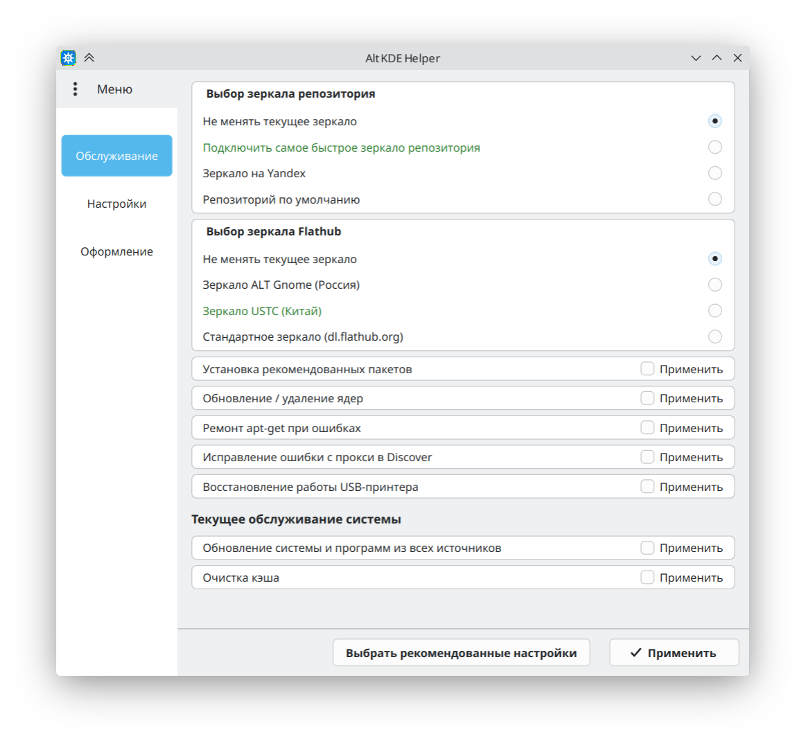
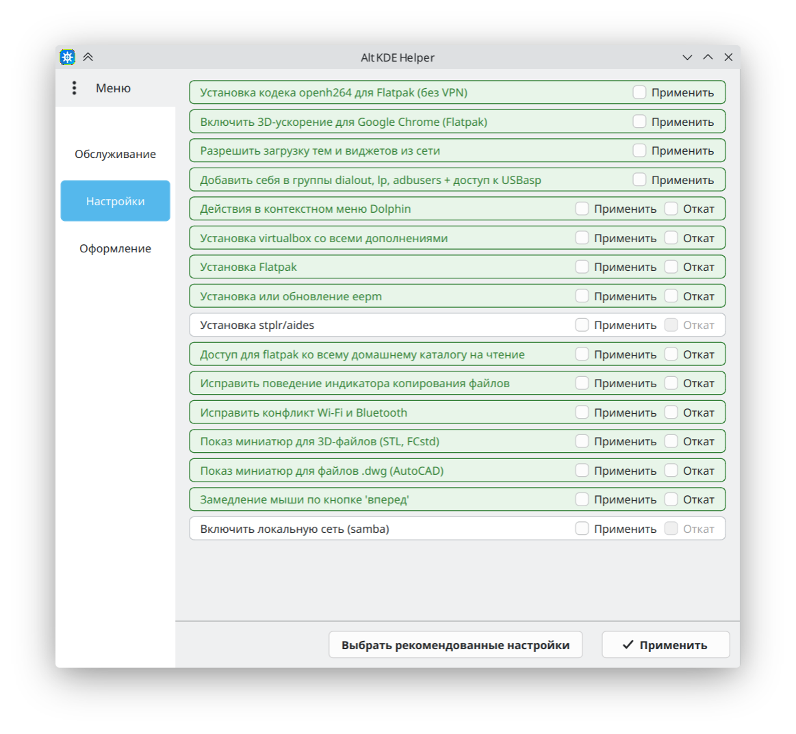
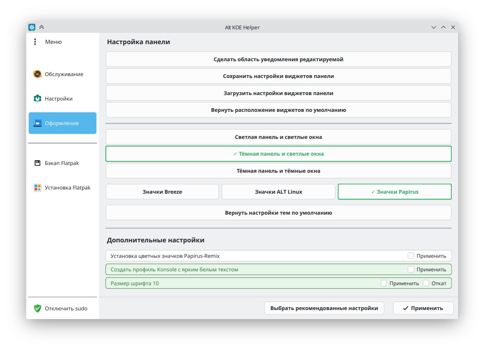
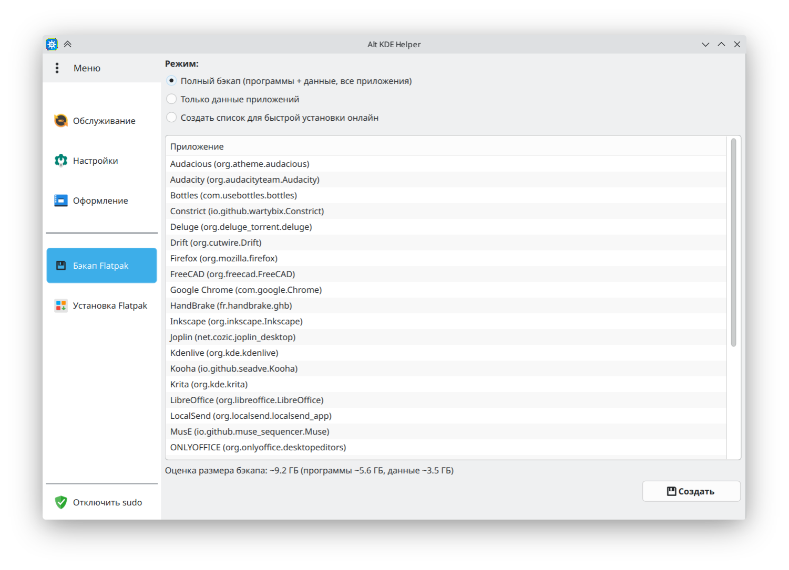
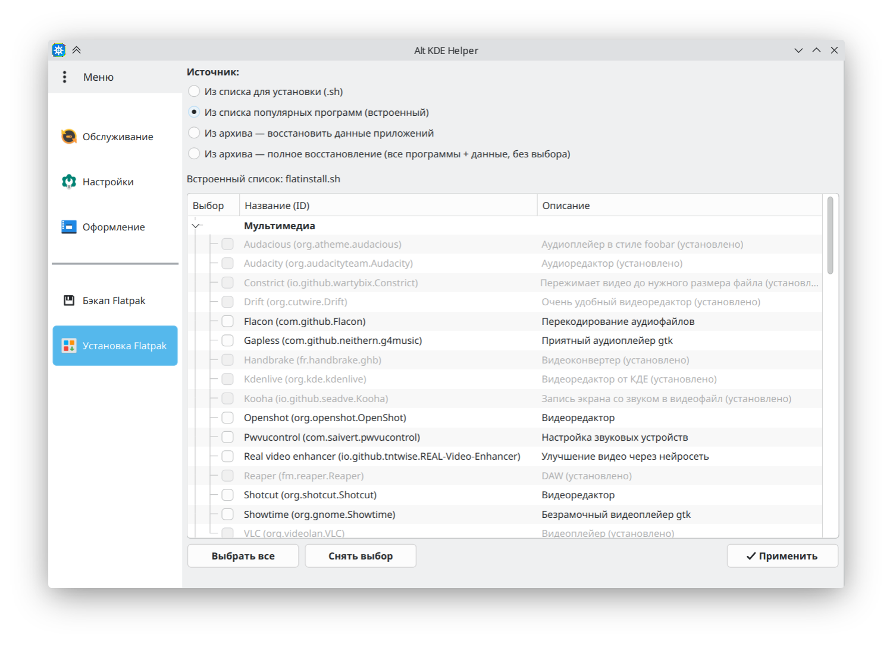

# Alt KDE Helper

<h2 align="center"><em>«Пользователь должен улыбаться, а не красноглазить»</em></h2>

## Описание программы

Программа предназначена для настройки и обслуживания операционных систем ALT Linux 11 с рабочим столом KDE6 — KWorkstation и особенно Starterkit, который можно одним кликом привести в полностью готовый для работы дистрибутив, оставаясь быстрым и лёгким, но полностью функциональным. Добавлена экспериментально поддержка Sisyphus, но без каких-либо гарантий, так как это тестовый, постоянно меняющийся репозиторий. Также заранее добавлена поддержка p12, так как на Сизифе сейчас все работает корректно.
Форум для обсуждения: https://forum.altlinux.org/index.php?topic=49855.0

Зеркало на altlinux.space: https://altlinux.space/kullibbin/alt-kde-helper/packages

**Основные функции:**

- установка доп. пакетов для получения максимально настроенной системы, особенно актуально для StarterKit и Regular. Редактировать список пакетов можно в меню, в левом верхнем углу приложения
- включение отключенных по умолчанию опций (например, загрузку виджетов и тем)
- получение sudo и прав на его использование
- **отключение sudo одной кнопкой в левой панели программы** — после настройки системы вы можете вернуть её в безопасное состояние, закрыв доступ к правам администратора
- настройка современного интерфейса в один клик — три режима (светлая/светлая, тёмная/светлая, тёмная/тёмная) с автоустановкой иконок Papirus и возможностью отката к предыдущему виду
- добавление пользователя в группы lp, dialout, adbusers, настройка прав для USBasp устройств
- установка VirtualBox со всеми дополнениями
- загрузка кодека openh264 без применения VPN
- выбор зеркал репозитория (есть выбор самого быстрого по результатам теста). Автоматически определяется p11, p12  или Sisyphus. Выбор зеркал flathub
- включение создания миниатюр для значков файлов 3D-моделей, FreeCAD и AutoCAD
- установка и удаление дополнительных источников приложений: Flatpak, Stapler (stplr), epm
- обновление самого пакета eepm и программ из epm play
- ремонт apt-get при ошибке базы данных
- исправление ошибки Discover после использования прокси
- доступ для Flatpak ко всему домашнему каталогу на чтение — для возможности перетаскивать файлы мышкой на окно приложения. Это безопасно, так как если программе изначально нужен такой доступ — она его по умолчанию уже имеет
- глубокая очистка кэшей — в домашнем каталоге, для обычных и Flatpak-приложений, удаление старых журналов и сжатие до размера 100 МБ максимум, очистка кэша пакетов (без применения небезопасной опции autoremove), удаление неиспользуемых рантаймов Flatpak
- очистка данных от удалённых Flatpak-приложений — находит в `~/.var/app` папки приложений, которых больше нет в системе, показывает их список с именами и перемещает в корзину по подтверждению
- архивация и восстановление Flatpak-приложений полностью оффлайн — без интернета. Можно сохранить все программы вместе с данными, чтобы потом восстановить их оффлайн, либо сохранить только данные и настройки (пароли, закладки, историю, сессии, переписки). Восстановить бэкап можно на этой же или другой машине
- создание своего списка программ для быстрой пакетной установки через интернет: программа сохранит все ваши Flatpak-приложения в отдельный список, по которому на другом компьютере всё установится в один клик. При этом можно ставить как все приложения сразу, так и выбрать нужные. Можно и наоборот — взять готовый встроенный список популярных приложений, выбрать нужные и установить их одним кликом
- установка новых ядер и удаление неиспользуемых
- включение и отключение автостарта сервиса samba для обеспечения работы локальной сети
- добавление в контекстное меню Dolphin пунктов «Открыть как текст» и «Сделать исполняемым»
- управление панелью KDE: применение пресета с редактируемым системным треем, сохранение и загрузка настроек панели в архив, возврат к заводским настройкам
- и другие опции, все показано на скриншотах

При наведении мыши на любой пункт появляется подсказка с описанием действия.

Кнопка **«Выбрать рекомендованные настройки»** одним кликом включает набор настроек, которые обычно делает каждый пользователь после установки системы.

## Скриншоты

## Установка. Сначала обновите систему!

### Установка через RPM-пакет

Скачайте файл alt-kde-helper-х.х.х-alt1.noarch.rpm со страницы релизов:

https://github.com/kullibbin-hub/alt-kde-helper/releases/latest

x.x.x - версия пакета.

**Установка через Discover**

Правым кликом по файлу → Открыть с помощью → Discover.

Если в течение нескольких секунд вверху окна не появляется кнопка для установки пакета, посмотрите в меню в верхнем правом углу окна (три точки).

После установки программа появится в меню KDE в разделе "Система".

**Установка через терминал**

1. Положите скачанный файл в вашу домашнюю папку /home/ваш_логин/
2. Откройте терминал и выполните команду `su -` (через пробел), введите пароль root
3. Затем выполните: `apt-get install /home/$(logname)/alt-kde-helper-х.х.х-alt1.noarch.rpm`

х.х.х - подставьте версию, как в файле пакета

### Установка из репозитория на altlinux.space (зеркало)

Добавьте репозиторий в свой список репозиториев. Откройте терминал, выполните `su -` (через пробел), введите пароль, Enter. Затем выполните: `apt-repo add rpm https://altlinux.space/api/packages/kullibbin/alt/alt.repo $(uname -m) classic`

Чтобы установить пакет, выполните следующие команды: `apt-get update`, затем `apt-get install alt-kde-helper`

## Как пользоваться

1. Выберите нужные действия на вкладках **«Настройки»**, **«Обслуживание»** или **«Оформление»**
2. Нажмите кнопку **«Применить»**
3. Откроется терминал, в котором будут выполняться указанные действия
4. После выполнения всех действий появится сообщение **«Нажмите любую клавишу»**
5. Нажмите любую клавишу или закройте окно терминала
6. Кнопка **«Выбрать рекомендованные настройки»** автоматически включает чекбоксы рекомендуемых автором настроек. При повторном нажатии — чекбоксы снимаются
7. Многие настройки правильно применяются после перезахода в сеанс, а обновления — после перезагрузки компьютера
8. Многие операции требуют ввода пароля в терминале при выполнении. Если появляется надпись `[sudo] password for ... (ваш логин)` — требуется ввести ваш пароль. Символы НЕ отображаются, но вводятся! После чего нажать Enter.
9. Подробная справка по работе с программой находится в меню-гамбургере (кнопка с тремя точками в левом верхнем углу). В конце справки указаны текущая версия программы и контактная информация для обратной связи.

## Особенности

- Действия с откатом имеют два чекбокса: «Применить» и «Откат»
- Откат доступен только после того, как действие было применено
- Выбор зеркала репозитория — радио-кнопки, автоматически удаляет другие варианты из очереди
- Важно: Если выбранное зеркало (например, самое быстрое или Yandex) не проходит проверку, автоматически возвращается зеркало по умолчанию
- sudo устанавливается в процессе установки программы и настраивается для пользователя при первом ее запуске, с подтверждение… его можно ещё раз применить при необходимости
- В заголовке «Текущее обслуживание системы» есть общий чекбокс для группового выбора всех трех действий
- Действие считается примененным только если все пункты этого действия выполнены, подробности в подсказке (по наведению мыши). Если, например, Flatpak установлен, а плагина для Discover нет, то считается, что действие не выполнено, но его можно выполнить еще раз, тогда установятся все пакеты
- Кнопки управления панелью на вкладке «Оформление» выполняются сразу, без нажатия «Применить». Остальные действия на этой вкладке (размер шрифта, значки, профиль Konsole) применяются через общую кнопку «Применить»

## Вкладка «Оформление»

В этой вкладке находятся кнопки для быстрого управления конфигурацией панели задач KDE Plasma. Действия выполняются сразу при нажатии кнопки, без использования терминала.

- **Сделать область уведомления редактируемой** — применяет встроенный пресет, при котором значки громкости, раскладки клавиатуры, подключённых устройств и другие элементы выносятся из системного трея как отдельные виджеты. Это позволяет свободно перемещать их по панели и настраивать независимо. *Внимание: добавленные вручную виджеты будут удалены, их потребуется добавить заново.*
- **Сохранить настройки виджетов панели** — создаёт архив `tar.gz` с текущим файлом конфигурации панели (`plasma-org.kde.plasma.desktop-appletsrc`). Вы можете выбрать любое имя для архива и место сохранения в своём домашнем каталоге.
- **Загрузить настройки виджетов панели** — восстанавливает конфигурацию панели из ранее сохранённого архива `tar.gz`. Программа автоматически проверяет наличие нужного файла внутри архива перед применением.
- **Вернуть расположение виджетов по умолчанию** — удаляет текущий файл конфигурации панели и перезапускает Plasma, возвращая панель к заводскому виду. *Внимание: все добавленные вручную виджеты будут удалены. Требуется подтверждение.*

### Современный интерфейс в один клик

Если система выглядит устаревшей, в один клик можно применить современное оформление. Доступно три режима: светлая панель и светлые окна, тёмная панель и светлые окна, тёмная панель и тёмные окна. При нажатии программа автоматически увеличит шрифт до 10, включит темы Breeze, установит иконки Papirus (если их нет) и перезапустит панель для мгновенного применения. Если результат не понравится, кнопка **«Вернуть предыдущий интерфейс»** вернёт всё как было.

## Бэкап и восстановление Flatpak

Flatpak-приложения и их данные можно сохранить в архив и восстановить на этой же или другой машине — полностью оффлайн, без интернета. Это удобно при переустановке системы или переезде на новый компьютер: пароли, закладки, история, сессии, переписки останутся на месте.

### Бэкап Flatpak

На вкладке «Бэкап Flatpak» можно сохранить приложения и их данные в архив. Перед началом программа закроет все запущенные Flatpak-приложения и очистит их кэши — это нормально, ничего не потеряется.

Три режима на выбор:

- **Полный бэкап** — программы вместе с данными и настройками. Позволяет восстановить всё оффлайн, без интернета.
- **Только данные** — настройки, пароли, закладки, история, сессии, переписки. Сами программы в архив не попадают — удобно, когда нужно перенести настройки на другую машину, где программы уже установлены.
- **Список для онлайн-установки** — текстовый список ваших Flatpak-приложений, по которому их можно быстро поставить на другом компьютере через интернет (см. ниже).

После создания архивы проверяются на целостность. Если проверка не прошла — программа сообщит об этом. Размер архива показывается по мере создания, чтобы было видно, сколько места он занимает.

### Восстановление Flatpak

На вкладке «Установка Flatpak» — четыре режима восстановления:

- **Из .sh-скрипта (установка)** — по списку программ, сохранённому ранее, всё установится через интернет. Можно поставить всё сразу или выбрать нужные приложения.
- **Из популярных (встроенный список)** — готовый список популярных Flatpak-приложений по категориям. Выбираете нужные — и они устанавливаются одним кликом. Требуется интернет.
- **Из архива (только данные)** — распаковка данных и настроек из архива. Сами программы должны быть уже установлены.
- **Из архива (полное)** — восстановление всего из архива: сначала данные, потом системные программы, потом пользовательские настройки. Полностью оффлайн, интернет не нужен.

**Про список для онлайн-установки:** файл `.sh` можно использовать двумя способами. Открыть в диалоге онлайн-установки и выбрать нужные приложения — или запустить в консоли, и тогда установится всё подряд, без участия программы.

**Важно про полное восстановление:**

- Системные программы заменятся для ВСЕХ пользователей компьютера. Данные и настройки — только для текущего пользователя.
- Другим пользователям, если они есть, после восстановления нужно будет обновить программы через интернет.
- Потребуется ввести пароль. Символы при вводе не отображаются, но вводятся.
- В конце рабочий стол перезапустится сам — это нормально, ничего делать не нужно.

## Отключение sudo (безопасность)

В левой панели программы (в самом низу) есть кнопка **«Отключить sudo»**. 

В ALT Linux по умолчанию доступ к sudo отключен на уровне системы (для безопасности). Программа включает его для своей работы, но после того как вы всё настроили, вы можете отключить его обратно одной кнопкой. 

При нажатии программа предупредит, что sudo будет отключен для **ВСЕХ** пользователей. После подтверждения и ввода пароля доступ будет закрыт, а программа закроется. Если sudo снова понадобится, просто запустите Alt KDE Helper — при первом запуске она заметит это и предложит снова его включить.

## Обновление ядра

В разделе **«Обслуживание»** есть пункт **«Обновление / удаление ядер»**. При его выборе открывается список всех доступных в репозитории ядер с пометкой текущего. Можно установить любое доступное ядро (не обязательно самое новое) или переключиться на уже установленное. После установки ядра ненужные ядра можно удалить, оставив лишь текущее и свежеустановленное. Если новое ядро не устанавливалось (выбор 0), то по запросу на удаление удалятся все остальные ядра, кроме текущего. Это безопасно, так как всегда можно заново установить любое ядро. Удаление производится только после явного подтверждения действия нажатием `y`, по простому нажатию Enter удаление будет отменено.

**Важно:**
- После обновления требуется перезагрузка компьютера, чтобы загрузилось новое ядро. Новое ядро автоматически становится по умолчанию.
- Если в репозитории отсутствуют модули для нового ядра (например, в репозитории Sisyphus), программа покажет предупреждение и не выполнит установку этого ядра.
- В случае проблем с новым ядром — всегда можно выбрать предыдущее ядро в меню загрузчика (Grub), которое появляется сразу при включении компьютера. Надо стрелками на клавиатуре выбрать в этом меню второй пункт и в открывшемся меню выбрать нужное ядро, без пометки «recovery».

## Установка VirtualBox

В разделе **«Настройки»** добавлен пункт **«Установка virtualbox со всеми дополнениями»**. Программа автоматически:

- Устанавливает пакет `virtualbox` и модули ядра для вашей текущей версии ядра
- Добавляет пользователя в группу `vboxusers`
- Отключает поддержку KVM (для совместимости)
- Скачивает Oracle Extension Pack и гостевые дополнения (ISO) в папку `~/Загрузки`
- Устанавливает Oracle Extension Pack (после подтверждения лицензии)
- Запускает и включает сервис `virtualbox.service`

**Лицензия Extension Pack:** распространяется под проприетарной лицензией PUEL, бесплатно для личного и образовательного некоммерческого использования. Подробнее: [https://www.virtualbox.org/wiki/ExtensionPack](https://www.virtualbox.org/wiki/ExtensionPack)

**Важно:**
- Если для вашего текущего ядра нет модуля VirtualBox в репозитории — программа предложит обновить ядро через пункт «Обновление ядра и модулей» или загрузить предыдущее ядро, и повторить установку.
- После установки рекомендуется перезагрузить систему.
- При откате (кнопка «Откат») VirtualBox будет удалён, а поддержка KVM восстановлена.
- Скачанные файлы (Extension Pack и ISO) остаются в папке `~/Загрузки`.

## Установка драйверов NVIDIA

Инструкция: [https://alt-kde.wiki/graphics/nvidia/nvidia-drivers/](https://alt-kde.wiki/graphics/nvidia/nvidia-drivers/)

Общая вики Alt KDE: [https://alt-kde.wiki/wiki/](https://alt-kde.wiki/wiki/)

Процесс установки драйверов NVIDIA требует ответов на вопросы в терминале и перезагрузки, поэтому в данной программе не реализован.

**Рекомендованный способ из инструкции** — установка через `epm`.

В данной программе `epm` можно установить двумя способами:
- Пункт **«Установка eepm»** (в категории «Настройки»)
- Пункт **«Установка рекомендованных пакетов»** (в категории «Обслуживание»)

В обоих случаях `epm` установится автоматически.

## О программе

- **Автор:** kullibbin
- **Лицензия:** MIT
- **Исходный код:** [https://github.com/kullibbin-hub/alt-kde-helper](https://github.com/kullibbin-hub/alt-kde-helper)
- **Обратная связь:** kullibbin@gmail.com
